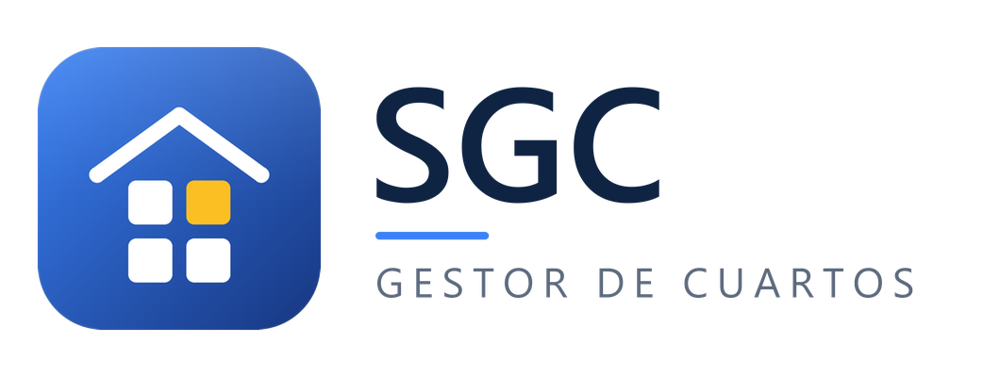

<p align="center">
  
</p>

<h1 align="center">Actualizaciones de SGC</h1>

<p align="center">
  Instaladores oficiales de <b>SGC - Sistema Gestor de Cuartos</b>: el sistema para administrar casas de huéspedes, edificios y hoteles.
</p>

<p align="center">
  <a href="https://github.com/Chava-27/SGC-actualizaciones/releases/latest"></a>
  <a href="https://github.com/Chava-27/SGC-actualizaciones/releases/latest"></a>
  
  
</p>

<p align="center">
  <a href="https://github.com/Chava-27/SGC-actualizaciones/releases/latest"><b>⬇ Descargar la última versión</b></a>
</p>

---

## ¿Tengo que hacer algo?

**No.** Si ya usa SGC, el programa se actualiza desde aquí sin que usted entre a esta página:

1. Al abrir SGC, revisa si hay una versión nueva. No frena el arranque y no pasa nada si no hay internet.
2. Si la hay, avisa en la **campana** 🔔 con lo que trae de nuevo.
3. El **Propietario** o un **Administrador** pulsa **Actualizar ahora** (también en *Sistema → Buscar actualizaciones*).
4. SGC descarga la versión, comprueba que sea auténtica, se cierra, se instala y vuelve a abrir solo.

> **Sus datos no se tocan.** Todo vive en la base de datos de SQL Server. Antes de cualquier cambio en la base, SGC saca un respaldo.

---

## Instalar SGC por primera vez

**Lo que necesita**

| | |
|---|---|
| Sistema | Windows 7 SP1 o más nuevo, con .NET Framework 4.8 (el instalador lo revisa) |
| Base de datos | SQL Server 2016 SP1 o más nuevo. **SQL Server Express es gratis y sirve** |
| Licencia | SGC empieza con **30 días de prueba** con todo incluido |

**Pasos**

1. En la computadora que hará de **servidor**, instale SQL Server Express.
2. Descargue `SGC_vNN_instalacion.exe` de la [última versión](https://github.com/Chava-27/SGC-actualizaciones/releases/latest) y ejecútelo.
3. Elija el tipo de instalación y marque **Crear o actualizar la base de datos en ESTE equipo**.
4. Abra SGC. El asistente de bienvenida pide los datos del negocio y crea la cuenta del **Propietario**.
5. En las **demás computadoras**, instale SGC *sin* marcar la base de datos y, al abrirlo, escriba el nombre del servidor en *Conexión*.

---

## Actualizar a mano

Sirve si una computadora no tiene internet o si prefiere hacerlo usted mismo.

1. Descargue el instalador de la [última versión](https://github.com/Chava-27/SGC-actualizaciones/releases/latest).
2. **Primero en el servidor** (la computadora donde está la base de datos): ejecútelo y deje marcada la tarea de la base. Pone la base al día con un respaldo previo.
3. Después, en cada una de las demás computadoras.

Si una computadora abre SGC antes de que el servidor esté actualizado, SGC se lo dirá con un mensaje claro: *"Actualice primero el equipo servidor"*.

---

## ¿Es seguro?

Cada versión trae un `manifiesto.json` con su número, fecha, notas, tamaño y **huella SHA-256** del instalador. Ese manifiesto va **firmado digitalmente** con una clave que solo tiene el proveedor de SGC.

SGC solo instala una versión cuando:

- ✅ la firma del manifiesto es válida,
- ✅ la huella del archivo descargado coincide exactamente con la firmada,
- ✅ la descarga fue por HTTPS,
- ✅ y es **más nueva** que la que ya tiene (nunca regresa a una versión anterior).

Si alguien cambiara un solo byte del instalador o del manifiesto, SGC lo rechaza.

<details>
<summary><b>Comprobar un instalador a mano</b></summary>

En PowerShell, dentro de la carpeta donde lo descargó:

```powershell
Get-FileHash .\SGC_vNN_instalacion.exe -Algorithm SHA256
```

El resultado debe ser igual al valor `sha256` del `manifiesto.json` de esa misma versión.
</details>

---

## ¿Quién recibe cada versión?

Depende del plan de la licencia:

| Plan | Actualizaciones |
|---|---|
| **Permanente** | Todas, siempre |
| **Perpetua** | Las publicadas durante su año de actualizaciones |
| **Mensual, Trimestral, Semestral y Anual** | Todas, mientras la licencia esté vigente |
| **Prueba** | Todas, durante los 30 días |

---

## Qué hay en cada versión

| Archivo | Para qué sirve |
|---|---|
| `SGC_vNN_instalacion.exe` | El instalador de esa versión |
| `manifiesto.json` | Datos de la versión y huella del instalador, firmados |

Las notas de cada versión (qué trae de nuevo y qué se corrigió) están en su [página de versiones](https://github.com/Chava-27/SGC-actualizaciones/releases).

Las versiones marcadas como **Pre-release** son pruebas internas: SGC no las ofrece a nadie.

---

## Preguntas frecuentes

<details>
<summary><b>¿Necesito internet para usar SGC?</b></summary>

No. Solo para buscar y descargar actualizaciones. SGC funciona igual sin conexión.
</details>

<details>
<summary><b>¿Qué pasa si se corta la luz o el internet a media actualización?</b></summary>

Si se corta durante la descarga, no se instala nada: SGC solo instala un archivo completo y comprobado. Si se corta durante la instalación, vuelva a ejecutar el instalador; sus datos siguen en la base de datos.
</details>

<details>
<summary><b>¿Por qué no me aparece el botón Actualizar ahora?</b></summary>

Solo lo ven el Propietario y los Administradores. También puede ser que su licencia no incluya esa versión; en *Sistema → Buscar actualizaciones* se lo explica.
</details>

<details>
<summary><b>¿Aquí está el código de SGC?</b></summary>

No. Este repositorio solo publica los instaladores. El código fuente es privado.
</details>

---

<p align="center">
  <sub>SGC · Sistema Gestor de Cuartos · Para dudas sobre su licencia o una actualización, comuníquese con su proveedor de SGC.</sub>
</p>
